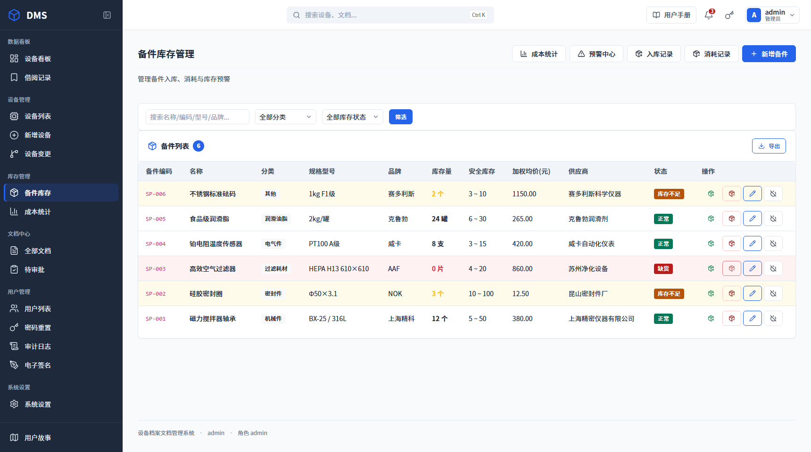

# 设备档案文档管理系统 (DMS)

<div align="center">


**面向制药企业的 GMP 合规设备档案与文档管理系统**

14 个业务模块 · 86 条路由 · 7 种角色权限 · 审计追踪与电子签名 · 响应式界面（手机可用）

[快速开始](#快速开始) · [功能概览](#功能概览) · [技术栈](#技术栈) · [项目结构](#项目结构) · [上线发布](#上线发布) · [文档](#文档)

</div>

---

## 这套系统解决什么问题

制药企业的设备要过 GMP 检查，绕不开三件事：**每台设备的档案是否完整**、**校准和维护是否按期做了且有记录**、**谁在什么时候改了什么是否可追溯**。这三件事靠 Excel 和纸质记录做，检查前必然要补材料。

DMS 把设备台账、文档档案、校准/维护计划、审批与电子签名、审计日志放在一套系统里：设备到期自动提醒，文档改版留历史版本，关键操作留审计痕迹，审批走电子签名而不是手签扫描件。

---

## 快速开始

### 本地跑起来（SQLite，零配置）

```bash
git clone https://github.com/feng197907/EquipmentManagement.git
cd EquipmentManagement

# Windows
py -3 -m venv .venv && .venv\Scripts\activate
# macOS / Linux
python3 -m venv .venv && source .venv/bin/activate

pip install -r requirements.txt
python app.py
```

打开 **http://127.0.0.1:5000**

首次启动会自动建表并写入默认账号，数据文件是项目根目录的 `dms.db`。

| 角色 | 用户名 | 密码 |
|---|---|---|
| 管理员 | `admin` | `admin123` |
| 设备工程师 | `user` | `user123` |

> 🔴 **生产环境务必先改掉这两个密码。**
> 它们是 `database.py` 里写死的初始化种子，本仓库是公开的，等于默认密码也是公开的。
> 部署完第一件事就是登录进去改密码（`用户管理 → 重置密码`），再考虑把种子改成随机值。

### 换成 MySQL / MariaDB

复制环境变量模板，把 `DB_TYPE` 改成 `mysql` 并填入连接信息，重启即可：

```bash
cp .env.example .env
vi .env
```

```ini
DB_TYPE=mysql
MYSQL_HOST=127.0.0.1
MYSQL_PORT=3306
MYSQL_USER=appuser_rw
MYSQL_PASSWORD=<你的密码>
SECRET_KEY=<python -c "import secrets;print(secrets.token_hex(32))">
```

表结构不用手动建，启动时会自动创建并执行增量升级。

---

## 功能概览

| 模块 | 能力 |
|---|---|
| **设备管理** | 台账新增/编辑/停用/报废，设备变更走审批，变更历史可查 |
| **设备看板** | 按状态（运行/维护/停用/报废/调试/待机/维修）统计与快速定位 |
| **校准管理** | 校准周期、到期预警、校准记录归档 |
| **维护管理** | 维护计划、执行记录、维修记录，支持关联备件消耗 |
| **备件管理** | 库存、入库（加权平均价）、消耗扣减、低库存/缺货/呆滞预警、成本统计 |
| **文档中心** | 上传、多版本管理、历史版本对比、按设备分类归档 |
| **借阅管理** | 文档借出/归还/审批，资产流向可追踪 |
| **审批中心** | 文档审批、设备变更审批，支持电子签名 |
| **提醒中心** | 校准到期、维护到期、待审批、借阅中等待办聚合 |
| **审计追踪** | 关键操作全量留痕：谁、何时、改前值、改后值、原因、IP |
| **用户与权限** | 7 种角色、23 项细粒度权限，按角色分配 |
| **系统设置** | 审批开关、提醒阈值等运行参数在线调整，无需改代码 |

界面基于 CSS 变量做了响应式适配，390px 宽的手机上可以正常浏览和操作（表格首列吸附、低频列自动隐藏）。

---

## 权限系统

7 种角色，权限在 `config.py` 的 `ROLE_PERMISSIONS` 里定义：

| 角色 | 标识 | 权限数 | 职责 |
|---|---|:--:|---|
| 管理员 | `admin` | 17 | 全部功能，含用户管理、审计日志、系统设置 |
| 设备工程师 | `equipment_engineer` | 9 | 设备操作、校准、维护、备件 |
| QA 经理 | `qa_manager` | 5 | 质量审批、文档审批、报告查看、IQ/OQ/PQ |
| 验证工程师 | `validation_engineer` | 5 | 验证文档管理、IQ/OQ/PQ |
| 生产主管 | `production_supervisor` | 5 | 生产相关审批、文档审批 |
| 计量工程师 | `metrology_engineer` | 5 | 计量器具管理、设备校准 |
| 档案管理员 | `archivist` | 4 | 文档上传与归档 |

> 谁能处理审批待办，取决于是否拥有 `document_approval` 权限 —— 管理员、QA 经理、验证工程师、生产主管。

权限表里有一处值得留意的不一致：系统共定义 23 项权限，`admin` 只登记了 17 项，缺的 6 项（`validation_docs`、`production_approval`、`device_view`、`document_management`、`calibration_records`、`maintenance_records`）是其他岗位专属的。目前只有 2 项权限真正挂在路由上做校验，`admin` 都覆盖了，所以暂时不影响使用；`role_required` 装饰器里有显式的 admin 兜底，但 `permission_required` 没有。如果后续要严格按权限表管控，记得先给 `admin` 补齐，或给 `permission_required` 加上同样的兜底。

---

## 技术栈

| 层 | 选型 | 说明 |
|---|---|---|
| 后端 | Flask 3.1 + Jinja2 3.1 | 服务端渲染，无前后端分离 |
| 认证 | Flask-Login | Session 认证 + 角色装饰器 |
| 数据库 | MariaDB 10.6+（生产）/ SQLite（本地） | 同一套 SQL 层，靠 `database.py` 兼容两种方言 |
| WSGI | gunicorn 26（2 worker） | 容器内运行，绑定 `127.0.0.1:5000` |
| 前端 | Bootstrap 5.3.3 + 原生 JS | 已 vendor 到本地，不依赖 CDN，内网可用 |
| 样式 | 9 个 CSS 文件 + CSS 变量设计令牌 | 无构建步骤，改完刷新即生效 |
| 部署 | Docker Compose + 宿主 nginx | 应用容器化，数据库和 nginx 留宿主机 |

**没有 npm、没有打包步骤**：改完模板和 CSS 直接生效，部署时也不用前端构建。

---

## 项目结构

```
EquipmentManagement/
├── app.py                    # 应用工厂 create_app()，注册蓝图与 /healthz
├── config.py                 # 角色定义、权限矩阵、业务常量
├── database.py               # 建表、增量迁移、默认账号与默认设置
├── extensions.py             # Flask 扩展（LoginManager 等）
├── requirements.txt
├── Dockerfile                # python:3.11-slim + gunicorn + tzdata
├── docker-compose.yml        # 生产：host 网络，挂载 uploads/logs
│
├── blueprints/               # 路由层（15 个模块）
│   ├── auth.py               #   登录 / 注销
│   ├── devices.py            #   设备台账与详情
│   ├── device_changes.py     #   设备变更审批
│   ├── maintenance.py        #   维护计划、维护记录、维修记录
│   ├── spare_part.py         #   备件库存、入库、消耗、预警、统计
│   ├── documents.py          #   文档上传、版本、历史
│   ├── borrowing.py          #   借阅
│   ├── approvals.py          #   审批中心
│   ├── esign.py              #   电子签名
│   ├── dashboard.py          #   看板、提醒中心
│   ├── users.py              #   用户与权限
│   ├── settings.py           #   系统设置
│   ├── password.py           #   忘记密码 / 重置申请
│   └── search.py             #   全局搜索
│├── models/                   # 数据访问层
│   ├── user.py
│   ├── maintenance.py
│   ├── spare_part.py
│   └── electronic_signature.py
│
├── utils/                    # 横切能力
│   ├── decorators.py         #   权限装饰器 @require_permission
│   ├── audit.py              #   审计日志写入
│   ├── file_utils.py         #   上传文件校验与存储
│   ├── db_utils.py
│   ├── logging_config.py     #   日志配置（app.log / error.log）
│   ├── maintenance.py        #   校准/维护到期计算
│   └── helpers.py
│
├── templates/                # 35 个 Jinja2 模板
│   └── components/           #   可复用组件（电子签名弹窗等）
│
├── static/
│   ├── css/                  # 9 个样式文件：variables / base / layout /
│   │                         # components / pages / pages-enhanced / mobile …
│   ├── js/
│   └── vendor/               # Bootstrap、字体等本地依赖
│
├── uploads/                  # 用户上传的文档（挂载到容器，备份就备它）
├── logs/                     # 运行日志（挂载到容器）
│
├── deploy/                   # 部署脚本
│   ├── compose-deploy.sh     #   一键发布（拉代码 → 建镜像 → 换容器 → 等健康）
│   ├── status.sh             #   上线状态自检（只读，8 项）
│   └── nginx-*.conf.example  #   nginx 反代样例（HTTPS / HTTP 直连）
│
├── scripts/                  # 一次性脚本：仅 db/ 两个数据库迁移工具
├── docs/                     # 文档（见下方「文档」一节）
└── tests/                    # 测试
```

---

## 上线发布

生产环境：**应用跑在 Docker 容器里，MariaDB 和 nginx 留在宿主机**。容器用 `network_mode: host` 复用宿主机网络栈，所以容器看到的 `127.0.0.1:3306` 就是宿主机的 MariaDB，nginx 的 `proxy_pass http://127.0.0.1:5000` 也不用改。

服务器上（`/data/EquipmentManagement`）：

```bash
cd /data/EquipmentManagement
./deploy/compose-deploy.sh     # 拉代码 → 建镜像 → 换容器 → 等健康检查
./deploy/status.sh             # 8 项自检：版本 / 容器 / 健康 / 探针 / 版本号 / 镜像 / 磁盘
```

> 📘 **完整流程、每一步的预期输出、回滚方式、排错速查，见 [`docs/上线操作手册.md`](docs/上线操作手册.md)。**
> 上线这件事最容易踩的三个坑都写在里面：只 `restart` 不 `build`（代码不生效）、
> 忘了提静态资源版本号（用户看到旧样式）、改了表结构没进迁移清单（线上不加列）。

几个要点先记住：

- **改代码后必须 `build`**：`docker compose restart` 不会重建镜像，代码不会变。
- **改了 CSS/JS 要提版本号**：模板里 `?v=N` 是缓存开关，不发版就是旧样式。
- **表结构变更要进清单**：`database.py` 的 `_migrate_mysql_columns` 里加一条幂等 `ALTER TABLE`，容器启动时自动执行。项目没用 Alembic。
- **数据备份就是备两个目录**：`uploads/` 和数据库；容器删了重建不丢数据。

---

## 界面截图

<table>
  <tr>
    <td width="50%" align="center"><b>登录</b><br></td>
    <td width="50%" align="center"><b>设备看板</b><br></td>
  </tr>
  <tr>
    <td align="center"><b>设备列表</b><br></td>
    <td align="center"><b>设备详情</b><br></td>
  </tr>
  <tr>
    <td align="center"><b>备件库存（含库存预警）</b><br></td>
    <td align="center"><b>文档中心</b><br></td>
  </tr>
  <tr>
    <td align="center"><b>借阅管理</b><br></td>
    <td align="center"><b>审批中心</b><br></td>
  </tr>
  <tr>
    <td align="center"><b>提醒中心</b><br></td>
    <td align="center"><b>系统设置</b><br></td>
  </tr>
</table>

---

## 文档

| 文档 | 受众 | 内容 |
|---|---|---|
| 🚀 [**上线操作手册**](docs/上线操作手册.md) | **运维 / 开发** | **日常发布必看**：本地提交、Docker 操作、服务器发布三条路径、回滚、排错 |
| 📖 [使用手册](docs/使用手册.md) | 最终用户 | 功能操作、角色权限、常见问题 |
| 🏗️ [架构文档](docs/ARCHITECTURE.md) | 开发者 | 分层设计、蓝图划分、数据层、权限模型 |
| 💻 [开发指南](docs/DEVELOPMENT.md) | 贡献者 | 环境搭建、编码规范、测试 |
| 📡 [API 参考](docs/API_REFERENCE.md) | 集成开发者 | 路由参数、请求响应示例 |
| 📋 [产品需求文档](docs/PRD-2026-05-11.md) | 产品 / 需求方 | 2026-05 版 PRD，功能范围与验收口径 |

---

## 常见问题

| 问题 | 处理 |
|---|---|
| 登录后看不到菜单 | 检查账号角色是否分配了对应权限（`用户管理 → 菜单权限`） |
| 上传失败 | 确认格式在允许列表内（pdf/doc/docx/xls/xlsx/jpg/png），并检查 `uploads/` 写权限 |
| 页面 502 | 后端容器没起来：`docker compose ps` + `docker compose logs --tail 100 app` |
| 改了代码线上没变化 | 只 `restart` 没 `build`，见[上线操作手册](docs/上线操作手册.md) |
| 改了样式线上没变化 | 模板里的 `?v=N` 没提，浏览器还在用缓存 |
| 审计日志时间差 8 小时 | 容器缺 tzdata，镜像里已装并设 `TZ=Asia/Shanghai`，确认别改掉 |
| 本地想重置数据 | 停掉服务，删掉 `dms.db`，重启自动重建（**仅限本地，生产禁止**） |

---

## 许可

[MIT License](LICENSE)

---

<div align="center">

**如果这个项目对你有帮助，点个 ⭐ Star 支持一下**

</div>
